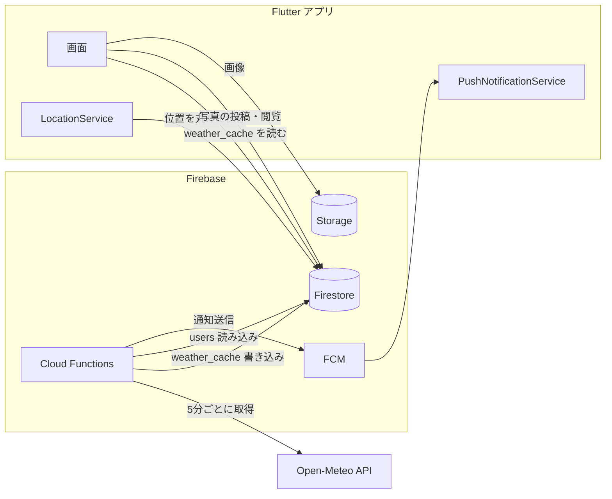

# 入道雲サーチ 仕様・設計書

現在地から見える範囲に入道雲が出現しそうなとき、プッシュ通知で知らせるアプリの現行仕様と設計をまとめたものです。
ユーザー向けの機能紹介は [README.md](README.md) を参照してください。本書は「いまのコードがどう動いているか」を記述します。

- 対象バージョン: `pubspec.yaml` 1.0.4+5
- 作成日: 2026-10-13（この時点の `main` ブランチのコードに基づく）

## 1. 概要

| 項目 | 内容 |
|------|------|
| 目的 | 現在地の東西南北に入道雲が発生しそうなとき通知し、撮影・共有まで楽しめるようにする |
| クライアント | Flutter（iOS / Android、縦画面固定） |
| バックエンド | Firebase（Cloud Functions / Firestore / Storage / FCM）、プロジェクト `thunder-cloud-app-292e6` |
| 気象データ | Open-Meteo Forecast API |
| 地図 | Google Maps |
| ユーザー識別 | ログインなし。端末ごとの FCM トークンと、端末内で生成した UUID |

## 2. 機能仕様

### 2.1 入道雲の監視と通知（中核機能）

- 監視地点: 現在地から **東西南北 4 方向 × 50km / 160km / 250km の 3 距離 = 12 地点**。
- 監視間隔: サーバーが 5 分ごとに判定する。
- 通知条件: いずれかの方向で、3 距離のうち 1 地点でも総合スコアが 50% 以上になったとき。
- 通知内容: タイトル「⛈️ 入道雲警報」、本文「north、east方向に入道雲が発生しています！」（方向名は英語のまま）。
- 通知対象: `isActive == true` で、**直近 24 時間以内に位置情報が更新されたユーザー**。アプリを 24 時間開いていないと通知は止まる。
- 夜間モード: 日本時間 20 時〜8 時は監視しない。

### 2.2 入道雲の判定ロジック

`functions/thunder_cloud_analyzer.js` が 1 地点ごとに 5 指標を 0〜1 に点数化し、重み付きで合計します。

| 指標 | 重み | 点数化の基準 |
|------|------|--------------|
| CAPE (J/kg) | 0.40 | ≥2500: 1.0 / ≥1000: 0.8 / ≥500: 0.6 / ≥100: 0.3 / それ未満: 0 |
| リフティド指数 | 0.30 | ≤-6: 1.0 / ≤-3: 0.8 / ≤0: 0.6 / ≤3: 0.4 / ≤6: 0.2 / それ超: 0 |
| 雲量 (%) | 0.15 | 全雲量・中層・高層の最大値で ≥80: 1.0 / ≥60: 0.8 / ≥40: 0.6 / ≥20: 0.3 / それ未満: 0 |
| 気温 (℃) | 0.10 | ≥30: 1.0 / ≥25: 0.8 / ≥20: 0.6 / ≥15: 0.4 / それ未満: 0 |
| CIN | 0.05 | ≤10: 0.3 / ≤50: 0.1 / それ超: 0 |

総合スコアによる判定:

| 総合スコア | リスクレベル | 入道雲あり判定 |
|-----------|-------------|----------------|
| 0.50 以上 | 高い | あり（通知・雲アイコン表示） |
| 0.30 以上 | 中程度 | なし |
| 0.15 以上 | 低い | なし |
| 0.15 未満 | 極めて低い | なし |

閾値と重みは `functions/constants.js` の `ANALYSIS_THRESHOLDS` / `SCORE_WEIGHTS` / `SCORE_VALUES` で一元管理しています。

### 2.3 画面

下部ナビゲーションの 3 タブ構成（`lib/main.dart` の `MainScreen`、`IndexedStack` で状態保持）。

| 画面 | ファイル | 内容 |
|------|---------|------|
| 入道雲（メイン） | `lib/screens/weather_screen.dart` | Google Maps 上に現在地と 4 方向の状況を表示。入道雲ありの方向は雲画像、なしは青空画像。30 秒ごとに再取得 |
| ギャラリー | `lib/screens/gallery_screen.dart` | 端末内に保存した写真の一覧・詳細・削除 |
| コミュニティ | `lib/screens/community_screen.dart` | 公開写真の一覧、いいね、ダウンロード、自分の投稿の削除。右下のボタンからカメラへ |
| カメラ | `lib/screens/camera_screen.dart` | 撮影 → プレビュー → 端末保存 / 投稿 |
| 設定 | `lib/screens/settings_screen.dart` | ユーザー情報（名前・アバター）、位置情報、気象データの詳細（CAPE などの生値と各スコア） |

### 2.4 写真・コミュニティ

- 投稿: 画像を Storage の `photos/{userId}/thunder_cloud_{ミリ秒}.jpg` に保存し、Firestore `photos` にメタデータを作成。
- 位置: 小数第 2 位（約 1km）に丸めて保存。地名は常に「撮影地点」。
- 保存期間: 投稿から **30 日**（`expiresAt`）。期限切れは日次バッチで Storage と Firestore の両方から削除。
- いいね: `photos` ドキュメントの `likedBy` 配列と `likes` カウンタを更新する方式。
- ダウンロード: 画像を取得して端末のフォトライブラリへ保存（`gal`）。
- ローカル写真: 画像ファイルは端末内、メタデータは `SharedPreferences` に保存。

### 2.5 位置情報とプライバシー

- 精度は `LocationAccuracy.medium`、1km 移動で位置更新イベントを受け取る。
- サーバーへ送る座標は小数第 2 位に丸める。
- プライバシーポリシー: `docs/privacy_policy.html`（GitHub Pages で公開）。

## 3. システム構成

ポイント: アプリは気象 API も Cloud Functions の HTTP API も直接呼びません。サーバーが書いた `weather_cache` を Firestore から読むだけです。

## 4. 処理フロー

### 4.1 起動時（`AppInitializationService`）

1. Firebase 初期化。
2. 通知サービス、位置情報サービス、ユーザー ID サービスを並列に初期化。
   - 通知権限を要求し、FCM トークンを取得（iOS は APNs トークンを待つ。最大 3 回リトライ、1 時間メモリキャッシュ）。
   - 端末 UUID を `SharedPreferences`（キー `unique_user_id`）から取得、なければ生成。
3. `users/{FCMトークン}` がなければ既定値で作成（最大 12 回、5 秒間隔でリトライ）。
4. 現在地を取得し、丸めた座標・`lastUpdated`・`isActive: true` を `users` に保存。

### 4.2 気象データのキャッシュ（`cacheWeatherData`、5 分ごと）

1. 夜間モードなら何もしない。
2. `isActive == true` で位置情報を持つユーザーを取得。
3. 全ユーザーの 12 地点を計算し、小数第 2 位に丸めたキーで重複を除く。
4. Open-Meteo に 100 地点ずつまとめて問い合わせる（バッチ間 2 秒待機、失敗したバッチは 1 地点ずつ再取得）。
5. ユーザー位置ごとに `weather_cache/weather_{緯度}_{経度}` へ、方向 × 距離ごとの生値と判定結果を保存。

### 4.3 入道雲の検知と通知（`checkThunderClouds`、5 分ごと）

1. 夜間モードなら何もしない。
2. アクティブかつ 24 時間以内に位置更新のあったユーザーを抽出。
3. ユーザーごとに 4 方向を調べ、各方向は 50km → 160km → 250km の順に判定し、1 地点でも「あり」ならその方向を確定。
4. 「あり」の方向が 1 つ以上あれば FCM で通知。

### 4.4 アプリでの表示

1. `weather_cache/{現在地のキー}` を 30 秒ごとに読む（アプリ復帰時、位置変更時にも読む）。
2. 方向ごとに 3 距離のうち最高スコアの地点を採用し、`isLikely` が true なら雲画像に切り替える。
3. フォアグラウンドで通知（`data.type == "thunder_cloud"`）を受けたときも、通知に含まれる方向で画面を更新する。

## 5. データ設計

### 5.1 Firestore

**`users/{FCMトークン}`**

| フィールド | 型 | 説明 |
|-----------|----|------|
| fcmToken | string | 通知の宛先（ドキュメント ID と同じ） |
| latitude / longitude | number | 小数第 2 位に丸めた現在地 |
| lastUpdated | timestamp | 位置の最終更新。通知対象の判定に使用 |
| isActive | bool | 監視対象かどうか |
| userId | string | 端末 UUID。写真の所有者 ID |
| userName | string | 既定値「ユーザー」 |
| lastThunderNotificationAt | timestamp | 直近の通知時刻。55 分以内の再通知を防止 |
| avatarUrl | string | Storage `avatars/` 配下の URL |
| appVersion / createdAt / updatedAt | | 管理用 |

**`weather_cache/weather_{lat}_{lon}`**（緯度経度は小数第 2 位）

| フィールド | 型 | 説明 |
|-----------|----|------|
| data | map | `{north|south|east|west: {"50km"|"160km"|"250km": 地点データ}}` |
| timestamp | timestamp | サーバーが最後に確認した時刻（5 分ごとに更新） |
| fetchedAt | timestamp | Open-Meteo から実際に取得した時刻 |
| location | map | `{latitude, longitude}` |
| cacheType | string | `multi_distance_directional`（定期バッチ）/ `standard`（HTTP API 経由） |

地点データ: `coordinates{lat,lon}`、`analysis{isLikely,totalScore,riskLevel,capeScore,liScore,cinScore,tempScore,cloudScore}`、`cape`、`lifted_index`、`convective_inhibition`、`temperature`、`cloud_cover`、`cloud_cover_mid`、`cloud_cover_high`。

**`photos/{自動ID}`**

| フィールド | 型 | 説明 |
|-----------|----|------|
| userId / userName | string | 投稿者 |
| imageUrl / thumbnailUrl | string | 現状は同じ URL |
| location | GeoPoint | 小数第 2 位に丸めた撮影位置 |
| locationName | string | 固定で「撮影地点」 |
| timestamp | timestamp | 投稿日時 |
| expiresAt | timestamp | 投稿から 30 日後 |
| likes / likedBy | number / string[] | いいね数といいねしたユーザー ID |
| isPublic | bool | 既定 true |
| tags / weatherData | string[] / map | 現状は空 |

インデックスは `firestore.indexes.json`（`photos` の timestamp・expiresAt・userId+timestamp・isPublic+timestamp、`users.isActive`、`weather_cache.timestamp`）。

### 5.2 Storage

| パス | 内容 |
|------|------|
| `photos/{userId}/thunder_cloud_{ミリ秒}.jpg` | 投稿写真 |
| `avatars/{ファイル名}` | プロフィール画像 |

### 5.3 端末内

| 保存先 | 内容 |
|--------|------|
| SharedPreferences `unique_user_id` | 端末 UUID |
| SharedPreferences（写真リスト） | ローカル写真のメタデータ（JSON 文字列のリスト） |
| アプリ内ストレージ | ローカル写真の画像ファイル |

## 6. バックエンド設計（Cloud Functions、Node.js 22）

### 6.1 関数一覧（`functions/index.js`）

| 関数 | 種別 | スケジュール | リージョン | 内容 |
|------|------|-------------|-----------|------|
| `cacheWeatherData` | 定期 | 5 分ごと | asia-northeast1 | 気象データを取得して `weather_cache` に保存（9 分タイムアウト、1GiB） |
| `checkThunderClouds` | 定期 | 5 分ごと | asia-northeast1 | 入道雲判定と通知（5 分タイムアウト、512MiB） |
| `monitorThunderClouds` | 定期 | `*/5 * * * *` | 既定 | `checkThunderClouds` と同じ判定・通知を行うバックアップ |
| `cleanupExpiredPhotos` | 定期 | `0 1 * * *` | 既定 | 期限切れ写真を最大 100 件削除 |
| `cleanupWeatherCache` | 定期 | `0 3 * * *` | 既定 | 2 時間より古いキャッシュを最大 100 件削除 |
| `getWeatherData` | HTTP | — | 既定 | `?latitude&longitude`。キャッシュ優先で 4 方向の最良地点を返す |
| `getDirectionalWeatherData` | HTTP | — | 既定 | 同上（キャッシュを使わず取得） |
| `getCacheStats` | HTTP | — | 既定 | キャッシュ件数の統計 |

HTTP API は夜間モード中、全方向「入道雲なし」の固定レスポンスを返します。

### 6.2 モジュール構成

| パス | 役割 |
|------|------|
| `constants.js` | 閾値・重み・距離・夜間時間帯・キャッシュキー生成 |
| `thunder_cloud_analyzer.js` | 判定ロジック（2.2） |
| `coordinate_utils.js` | 方向と距離から座標を計算（緯度 1 度 = 111km の近似） |
| `modules/weather/weather_api.js` | Open-Meteo 呼び出し（単一地点 / 複数地点一括） |
| `modules/weather/weather_service.js` | 方向別データの組み立て、アクティブユーザー分のキャッシュ |
| `modules/weather/weather_cache.js` | `weather_cache` の読み書き・掃除・統計 |
| `modules/monitoring/thunder_monitoring.js` | ユーザーごとの入道雲チェック |
| `modules/notification/notification_service.js` | FCM 送信（Android チャンネル `thunder_cloud_channel`） |
| `modules/cleanup/cleanup_service.js` | 期限切れ写真・古いキャッシュの削除 |
| `modules/handlers/*.js` | HTTP / スケジュールの入口 |
| `modules/utils/batch_processor.js` | 座標の重複除去と 100 地点ずつのバッチ処理 |

### 6.3 Open-Meteo へのリクエスト

`https://api.open-meteo.com/v1/forecast`、`hourly=cape,lifted_index,convective_inhibition,cloud_cover,cloud_cover_mid,cloud_cover_high`、`current=temperature_2m`、`timezone=auto`、`forecast_days=1`。API キーは不要。

## 7. クライアント設計（Flutter）

| ディレクトリ | 役割 |
|-------------|------|
| `lib/screens/` | 画面と、画面専用のサービス（`community/`、`gallery/`、`settings/`、`camera/`） |
| `lib/services/core/` | 起動時の初期化 |
| `lib/services/location/` | 位置取得、1km 移動監視、位置キャッシュ（有効 10 分） |
| `lib/services/notification/` | FCM トークン管理、プッシュ受信、ローカル通知 |
| `lib/services/weather/` | `weather_cache` の読み取り |
| `lib/services/photo/` | カメラ、投稿、ローカル保存、ユーザー情報 |
| `lib/services/user/` | 端末 UUID |
| `lib/constants/app_constants.dart` | 距離・方向・間隔・UI 寸法などの定数 |
| `lib/widgets/` | 地図背景、方向ごとの雲表示、共通 AppBar |

状態管理ライブラリは使わず、`StatefulWidget` + サービスの static キャッシュ + コールバック（`LocationService.onLocationChanged`、`PushNotificationService.onThunderCloudDetected`）で構成しています。

サーバーとクライアントで揃える必要がある定数: 監視方向・距離（`CHECK_DIRECTIONS` / `CHECK_DISTANCES`）、キャッシュキーの形式（`weather_{lat.2f}_{lon.2f}`）、夜間時間帯（20〜8 時）。

## 8. セキュリティルール（リポジトリ内の定義）

| 対象 | 読み取り | 書き込み |
|------|---------|---------|
| `users/{userId}` | 認証済みで本人のみ | 認証済みで本人のみ |
| `weather_cache` | 誰でも | 不可（Functions のみ） |
| `photos` | 公開かつ期限内、または所有者 | 作成・更新・削除は認証済みの本人 |
| `likes` | 期限内 | 認証済みの本人 |
| `downloads` / `debug` / `_test_connection` | 誰でも | 誰でも |
| Storage 全体 | 誰でも | 誰でも（「テスト用」のコメントあり） |

## 9. 現状の課題・仕様とコードのずれ

コードを読んで見つかった点です。優先度が高いと思う順に並べています。

0. **【2026-10-13 に修正をデプロイ済み・経過観察】Open-Meteo の 1 日あたりの上限を超え、気象データが取得できていなかった**（本番ログと Firestore で確認）
   デプロイ前の本番の `cacheWeatherData` は全リクエストが `429 Daily API request limit exceeded` で、`weather_cache` の全 16 件で 4 方向とも中身が空でした。アプリは天気に関係なく全方向「入道雲なし」を表示していました。約 16 地点 × 12 地点を 5 分ごとに取得しており、1 日 約 27,000 回になっていました（無料枠は 1 日 10,000 回）。
   2026-10-13 17:20（JST）にリポジトリの `functions/` を本番へデプロイし、直後の実行で 192 地点の取得成功、次の実行で再取得 0 件（1 時間間隔が有効）を確認しました。上限は接続元 IP 単位で Cloud Functions の IP は共有のため、再発しないかは数日ログで確認が必要です。本番にはリポジトリに無い `cleanupExpiredLikes` が残っています（デプロイ対象外にしたため）。また、気象データの取得対象は位置情報を持つ全ユーザー（20 人、1 年前の更新分を含む）ですが、通知の対象は 24 時間以内に位置を更新したユーザーだけ（同時点で 1 人）です。

1. **セキュリティルールとアプリの認証方式が合っていない**
   ルールは `users` / `photos` に `request.auth` を要求しますが、アプリは Firebase Authentication を使っていません（`pubspec.yaml` に `firebase_auth` なし）。リポジトリのルールをそのままデプロイすると `users` への書き込みや写真投稿が拒否されるはずなので、本番に適用されているルールとの差分を確認してください。あわせて Storage が全開放、`downloads` / `debug` / `_test_connection` も全開放です。

2. **FCM トークンをユーザーのキーにしている**
   トークンが更新されると新しい `users` ドキュメントができ、古いものは `isActive: true` のまま残ります（`updateUserActiveStatus` の呼び出し元なし）。通知側は 24 時間ルールで除外されますが、`cacheWeatherData` は 24 時間で絞らないため、古い位置の気象データを取り続けます。

3. **位置の Firestore 保存タイミング**
   確認できた範囲では、保存されるのは起動時と GPS を取り直したときです。1km 移動のイベントは画面の更新だけで、`users` の位置は更新していないように見えます。移動中に監視範囲が追従するかは実機で確認が必要です。

4. **日次バッチのタイムゾーンと処理件数**
   `cleanupExpiredPhotos` / `cleanupWeatherCache` は `timeZone` 未指定のため、日本時間の 1 時 / 3 時に動くとは限りません。また 1 回 100 件までなので、`weather_cache` は増えるペースに削除が追いつかない可能性があります。

5. **細かな不整合**
   - `AppConstants.appVersion` が `1.0.3`（`pubspec.yaml` は 1.0.4）。
   - `schedule_handlers.js` のコメントに「8 方向」「5km / 10km / 15km」など現行と違う記述が残っている。
   - `likes` コレクションと `downloads` コレクションはルールや読み取りコードだけ残っており、いいねは `photos.likedBy`、ダウンロードは端末保存で実装されている。
   - 通知本文の方向が `north` など英語のまま。
   - アプリは HTTP API（`getWeatherData` など）を呼んでおらず、`cloud_functions` パッケージも未使用。

### 修正済み（2026-10-13、Cloud Functions は同日デプロイ済み）

- 気象値が当日 0 時のものだった問題 → 現在時刻に対応する `hourly` の要素を使用。
- Open-Meteo の複数地点レスポンス（地点ごとの配列）を正しく処理できず、毎回 1 地点ずつの取得に落ちていた問題。
- 通知判定でキャッシュが使われていなかった問題 → ユーザー位置の `weather_cache` を読み、判定できない方向だけ API を呼ぶ。
- 重複通知と夜間の通知 → `monitorThunderClouds` に夜間判定を追加し、`users.lastThunderNotificationAt` で 55 分以内の再送を防止（通知は 1 ユーザーあたり最大 1 時間に 1 回）。
- Open-Meteo の上限超過 → 同じ地点の再取得は 1 時間に 1 回に制限（`WEATHER_FETCH_INTERVAL_MS`）。5 分ごとの実行は残し、取得間隔内は `weather_cache.timestamp` だけ更新する（リリース済みアプリが 5 分より古いキャッシュを無効扱いするため）。実際に取得した時刻は `fetchedAt` に保存。呼び出しは 192 地点 × 12 回 = 約 2,300 回 / 日。
- 上限超過（429）時に 1 地点ずつ再試行して呼び出しを倍増させていた問題、取得失敗時に空データや既定値（0）でキャッシュを上書きしていた問題。
- iOS の最低対応バージョンを 15.0 に変更（Xcode 27 は iOS 15 未満のビルドを受け付けない）。
- 期限切れ写真の Storage 画像が削除されていなかった問題。
- 投稿失敗が成功扱いになっていた問題、コミュニティの追加読み込みで同じ写真が重複する問題、アプリ更新後にローカル写真が消える問題。
