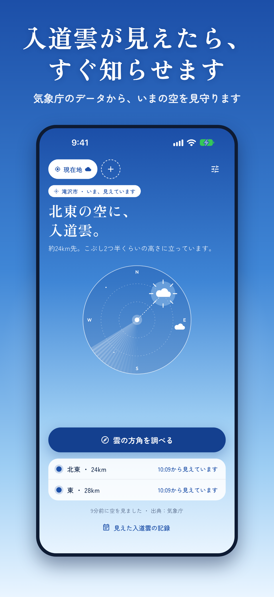
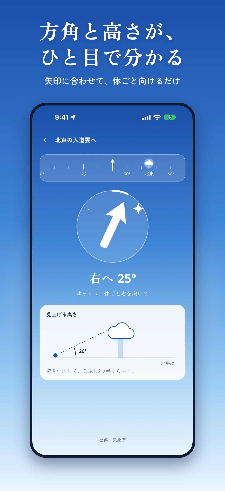
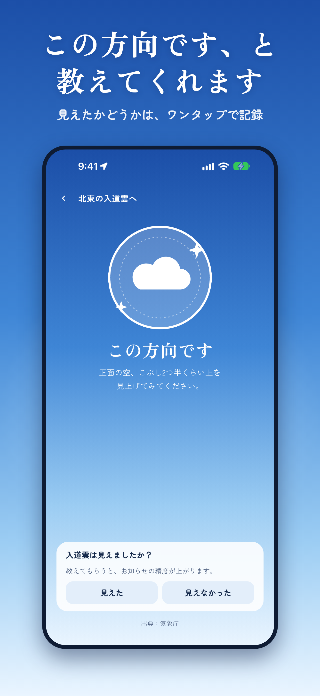
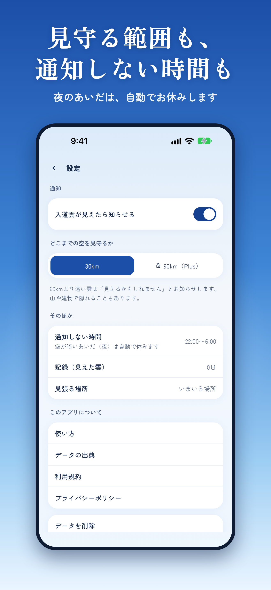

# 入道雲サーチ

あなたの場所から見える空に入道雲が現れたら、どの方角に、どのくらいの高さで見えるかを知らせるアプリです（Flutter + Firebase）。

アプリが「いつ・どこで入道雲ができそう」と予想することはしません。気象庁がいま観測しているデータから、すでにある雲を見つけて知らせます。

## アプリ画面

<p>
  
  
  
  
</p>

## 主な機能

- **入道雲の通知**: 見張る場所の近くに入道雲が見えたら、1つの雲につき1回だけ知らせます。「見えた」「見えなかった」のボタン付き。
- **方角ガイド**: 雲の方角と、見上げる高さ（こぶし何個分か）を、スマホを向けて確かめられます。
- **見える範囲**: 無料は30km、Plus は90kmまで。60kmより遠い雲は「見えるかもしれません」と伝えます。
- **見張る場所**: いまいる場所のほかに、無料で1か所。Plus なら3か所まで。
- **通知しない条件**: 雨が降っている、雲が近すぎる、一面の曇り、視程より遠い、見上げる角度が低すぎる、空が暗い時間など。
- **ウィジェット**（iOS、Android）、**見えた雲の記録**。
- Plus は月額と買い切りの2つ（RevenueCat で管理）。広告は出しません。

## データの出典

出典：気象庁ホームページ（加工して作成）。

- 雲の場所: 高解像度降水ナウキャスト、雷ナウキャスト
- 雲の背の高さと、まわりの雲の量: ひまわりの赤外画像
- 空のようす（日照、見通せる距離）: アメダス

気象庁へのアクセスはサーバー（Cloud Functions）が5分に1回、全ユーザー分をまとめて行います。アプリから直接は取りに行きません。しくみの詳細は [docs/検知のしくみ.md](docs/検知のしくみ.md)。

## プライバシー

[プライバシーポリシー](https://tsuchida-y.github.io/thunder_cloud_app/privacy_policy.html)、[利用規約](https://tsuchida-y.github.io/thunder_cloud_app/terms.html)

- 位置情報は、最初は「使用中」だけをお願いします。「常に」は、最初の入道雲の通知のあとに1回だけお願いします。
- 利用者は、設定の「データを削除」で、サーバーのデータをいつでも消せます。

## 開発者向け

### はじめかた

```bash
git clone https://github.com/tsuchida-y/thunder_cloud_app.git
cd thunder_cloud_app
flutter pub get
flutter run
```

Plus の購入を試すときは、公開用キーを渡します（`config/revenuecat.json`）。

```bash
flutter run --dart-define-from-file=config/revenuecat.json
```

### 技術

- アプリ: Flutter（iOS、Android）
- サーバー: Firebase（Cloud Functions、Firestore、Authentication、FCM）
- 課金: RevenueCat
- 気象データ: 気象庁

### 資料

作り直しの資料はすべて `docs/` にあります。はじめに読むもの:

- [docs/入道雲サーチ_仕様書.md](docs/入道雲サーチ_仕様書.md): 目的、画面、機能の仕様
- [docs/入道雲サーチ_決定事項.md](docs/入道雲サーチ_決定事項.md): データ・通知・有料プランを決めた理由
- [docs/引き継ぎメモ.md](docs/引き継ぎメモ.md): 作業のやり方（実機、TestFlight、ログ）
- [docs/残りの作業と確認事項.md](docs/残りの作業と確認事項.md): 残りの作業

Cloud Functions のデプロイは、必ず関数名を指定します（`firebase deploy --only functions:updateNowcastClouds` のように）。

## お問い合わせ

- 開発者: Tsuchida Yuto
- メール: yuto0419tsuchida@gmail.com
- GitHub Issues: https://github.com/tsuchida-y/thunder_cloud_app/issues
